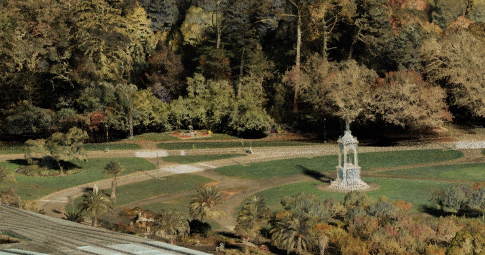

# Ouster point cloud viewer

Explore billion-point Ouster lidar captures in the browser: stream them, clean them, fly a guided tour,
measure, and share a link to an exact view.

**Live:** https://storage.googleapis.com/ouster-pointcloud-viewer/viewer/index.html



| Dataset | Capture | Points | Streams |
|---|---|---|---|
| Golden Gate Park, San Francisco | Drone, OS1 Max | 1.41 B | 13.8 GB COPC |
| Viansa Winery, Sonoma | Walking, OS1 Max | 7.59 M | 79 MB COPC |

**What it does**

- Streams [COPC](https://copc.io) files straight from a storage bucket with HTTP range requests: no server,
  and a 13.8 GB cloud opens in seconds because only what's on screen loads.
- Cleans noisy point clouds without deleting anything: floating noise and mis-colored speckle are
  *classified*, and the viewer hides them (Clean button), so it's reversible.
- Guided tours with captions, measurements (distance, height, area, point), orthographic and X-ray
  views, eye-dome lighting, screenshots, and share links that carry the camera and measurements.
- Built on [Potree 1.8.2](https://github.com/potree/potree) (WebGL) and [Vite](https://vitejs.dev).

---

## 1. Run it locally (2 minutes)

You need [Node.js](https://nodejs.org) 18 or newer.

```sh
git clone https://github.com/zachglabman/ouster-pointcloud-viewer.git
cd ouster-pointcloud-viewer/viewer
npm install
npm run dev
```

Open the address it prints (e.g. http://localhost:5173):

- `/` shows the live datasets, streamed from the public bucket.
- `/?config=datasets.sample.json` shows a 4.6 MB sample bundled with the repo (works offline).

## 2. View your own point cloud

This works with any point cloud PDAL can read: LAS, LAZ, COPC or PLY. **From Ouster Studio:** open a
recording, click the download icon, and under **Outputs → SLAM** download the **PLY**.

### a. Set up the processing tools (once)

[Miniforge](https://github.com/conda-forge/miniforge) (or any conda) gives you PDAL, untwine and scipy:

```sh
conda create -n pc -c conda-forge python=3.11 pdal python-pdal untwine scipy numpy
conda activate pc
```

### b. Clean and convert

```sh
# from the repo root
python clean/clean_cloud.py ~/Downloads/my_site.ply out/my_site --id my_site --capture walk
```

- `--capture walk` for walking or vehicle captures, `--capture drone` (default) for aerial ones.
- Every point is kept. You get:
  - `out/my_site.copc.laz`: the streamable cloud
  - `out/my_site.dataset.json`: a ready-to-paste viewer entry
  - `out/my_site.qa.png` and `.qa.json`: a review report (see [Cleaning](#cleaning))
- Time: about 20 s for 7.6 M points; a 1.4 B-point cloud takes 30 to 45 minutes on a 10-core Mac.
- Maps without color (reflectivity only) work too: they're shown by reflectivity, and the color-speckle
  step is skipped.

**Look at `out/my_site.qa.png` before going further.** It shows the original, what was flagged (red) and
the cleaned result for three sample areas.

### c. Try it in the local viewer

The dev server serves `out/` at `/data/`, so the new cloud streams locally exactly as it will online.

1. Open `viewer/public/datasets.json` and paste the contents of `out/my_site.dataset.json` into the
   `"datasets"` list. Its `"url"` is already `data/my_site.copc.laz`.
2. Replace the `<...>` placeholders in its `title`, `description` and `facts`.
3. Run `npm run dev` and pick your dataset from the switcher (bottom left).
4. Fly to a good opening view and press **P**: it copies that camera as JSON. Paste it as the dataset's
   `"camera"`, or into `"viewpoints"` / `"tour"`.

## 3. Put it online (Google Cloud Storage)

Everything is static files in one bucket: the site under `viewer/`, the clouds under `pointclouds/`.
You need the [gcloud CLI](https://cloud.google.com/sdk/docs/install) and a Google Cloud project.

### a. One-time setup

```sh
cp hosting/.env.example hosting/.env      # set PROJECT and BUCKET
cp viewer/.env.example  viewer/.env       # optional: site URL for link previews, analytics IDs
gcloud auth login
sh hosting/gcs-setup.sh bucket            # creates the bucket with CORS for range requests
sh hosting/gcs-setup.sh public            # makes it world-readable (needed for a public viewer)
```

### b. Publish a point cloud

```sh
sh hosting/gcs-setup.sh publish out/my_site.copc.laz
```

It prints the public URL; put it in the dataset's `"url"`.

- Data files are cached for a year, so **a changed cloud needs a new file name** (e.g. `my_site-v2`).
  `publish` refuses to overwrite.
- If the review report status is `hold`, `publish` refuses; check the PNG, then `FORCE=1 sh ... publish`.

### c. Deploy the site

```sh
sh hosting/gcs-setup.sh site              # builds the viewer and uploads it
```

`index.html` and `datasets.json` are never cached, so copy edits are live on the next page load.

## 4. Configure

### `viewer/public/datasets.json`

```jsonc
{
  "default": "my_site",                 // dataset shown first
  "ui": { "switcher": true, "cta": true, "tour": true, "share": true,
          "measure": true, "image": true, "advanced": true },   // turn parts of the UI off (e.g. for an embed)
  "datasets": [ { /* one entry per point cloud, fields below */ } ]
}
```

| Field | Meaning |
|---|---|
| `id`, `name`, `title` | URL key (`#d=<id>`), switcher label, info-card heading |
| `url` | the `.copc.laz` (absolute, or relative to the site) |
| `description`, `facts` | info-card text and the small chips under it |
| `thumbnail` | switcher image, 176 × 120 (`thumbs/<id>.jpg`) |
| `cta` | `{ "label", "url" }` button in the info card |
| `camera` | opening view: `{ "position": [x,y,z], "target": [x,y,z] }` (press **P** in the viewer) |
| `viewpoints` | "Jump to" chips: `[{ "name", "position", "target" }]` |
| `tour` | guided tour stops: `[{ "name", "chip", "caption", "position", "target", "hold" }]` |
| `colorMode`, `colorModes` | default and available looks (`rgb`, `reflectivity`); Height is always added |
| `noiseClassified`, `speckle`, `skyFilter`, `clean` | cleaning presets (written by `clean_cloud.py`) |
| `pointBudget`, `maxFlySpeed` | points on screen (desktop; phones cap at 2 M) and fly-mode speed cap |
| `autoOrbit` | slowly circle the opening view until the visitor moves |
| `dev` | only listed with `?dev=1` |

### `viewer/.env` (build time, optional)

| Variable | Meaning |
|---|---|
| `VITE_SITE_URL` | public URL of the deployed viewer folder, for link previews (`og:url`, `og:image`) |
| `VITE_GA4_ID` | Google Analytics 4 measurement ID (production builds only) |
| `VITE_GTM_ID` | Google Tag Manager container |

### URL parameters

| Parameter | Meaning |
|---|---|
| `#d=<id>&cam=…&m=…` | dataset, camera, measurements (what **Share** copies) |
| `#d=<id>&tour` | open straight into the guided tour |
| `?config=<file>.json` | another dataset list from the same site (relative paths only) |
| `?stats=1`, `?advanced=1`, `?dev=1` | performance overlay, open the Advanced panel, list `dev` datasets |
| `?debug-analytics=1` | log analytics events to the console |

Keys: **G** fly mode, **M** measure, **O** orthographic, **X** X-ray, **T** top view, **1/2/3** color
modes, **N** noise show/hide/only, **P** copy camera JSON, **Esc** cancel, **⌘Z** undo.

## Cleaning

`clean/clean_cloud.py` classifies, never deletes. The viewer's **Clean** button and the Advanced →
Cleaning sliders decide what's hidden.

| Class | Defect | Detector |
|---|---|---|
| 7 | floating noise: specks in the air, points below the ground | statistical outlier (mean distance to 12 neighbors > mean + 3 sd) + `filters.elm` |
| 65–71 | color speckle: bright or sky-colored dots on real surfaces (tree and roof edges, wires) | `clean/speckle.py`: brighter and differently colored than nearby surfaces; 8 strength bands |

- Speckle is a color defect, so maps without color only get the noise class.
- `--capture walk` compares each point with the best-matching nearby surface instead of the
  neighborhood average, so narrow bright ground next to dense plants (sand paths, curbs) isn't flagged.
- Inputs over 40 M points are processed in 100 m tiles with a 3 m overlap, merged with untwine, and the
  point count is checked against the source.
- **Review report:** `qa.png` (original / flagged / cleaned for the densest, a typical and the
  most-flagged area) and `qa.json`. Status `hold` (noise > 2%, speckle > 8%, or a sampled area > 25%
  flagged) blocks `publish` until you've looked.

## Guided tour

Add a `"tour"` list to a dataset. Visitors click **▶ Take the tour** or open `#d=<id>&tour`.

- The camera eases between stops and arcs over long hops. During each flight it downloads the
  destination's detail first.
- A stop doesn't move on until its view has loaded (25 s cap). Then it drifts slowly while the caption
  shows, and downloads the next stop.
- **← / →** step through stops and **Space** pauses. Any drag, scroll or other key hands control back to
  the visitor.

## Analytics

Set `VITE_GA4_ID` (and/or `VITE_GTM_ID`) in `viewer/.env` and redeploy. Every event carries the
`dataset`: `dataset_view`, `cta_click`, `share`, `measure`, `screenshot`, `nav_mode`, `xray`, `ortho`,
`clean`, `advanced_open`, `viewpoint`, `tour_start`, `tour_stop_reached`, `tour_stop_loaded` (with
`seconds` waited), `tour_stop`, `tour_complete`.

## Performance notes

- Loading is bandwidth-bound: a sharp 16 M-point view is about 50 MB. The point budget is the main dial.
- 24 parallel downloads (measured best), a 4 px cap on point size (no blobs while detail streams in), a
  "Refining detail…" indicator, and adaptive render resolution (up to 2× on desktop, 1.5× on phones).
- Merging adjacent chunk requests was tried and dropped: requests merged only 0–30% in typical views.
- `hosting/cdn-setup.sh` puts Cloud CDN and a custom domain in front of the bucket (about $18/month).
  It's optional and not in use.

## Project layout

```
clean/clean_cloud.py      clean + convert any LAS/LAZ/COPC/PLY to COPC (+ dataset.json, review report)
clean/speckle.py          the color-speckle score
clean/run_ggp.py          the original Golden Gate Park run (kept for reference)
sky/                      Viansa's one-off sky-fringe score (stored in Intensity)
hosting/gcs-setup.sh      bucket, publish data, deploy site, range-request check   (settings: hosting/.env)
hosting/cdn-setup.sh      optional Cloud CDN + custom domain
viewer/index.html         page shell, link-preview tags
viewer/src/main.js        settings, toolbar, panels, share links, keys, loading
viewer/src/tour.js        guided tour
viewer/src/tools.js       measurements, axis gizmo, screenshots
viewer/src/analytics.js   analytics events
viewer/public/            datasets.json, datasets.sample.json, sample cloud, thumbnails, Potree bundle
viewer/patches/           our changes to Potree 1.8.2 (shader filters)
viewer/vite.config.js     dev range server for out/, build-time .env injection
```

## Rebuilding Potree

The viewer ships a built Potree 1.8.2 with a small shader patch (reflectivity and height filters,
tagged `[ggp]`). You only need this to change Potree itself:

```sh
cd viewer
git clone --branch 1.8.2 --depth 1 https://github.com/potree/potree.git vendor/potree-1.8.2
git -C vendor/potree-1.8.2 apply ../../patches/potree-1.8.2-ggp.patch
(cd vendor/potree-1.8.2 && npm install && npx gulp build)
npm run sync-potree     # copies only what the viewer loads into public/potree
```

## Roadmap: Ouster Studio integration

Goal: every Studio recording opens its SLAM map in this viewer. Studio already produces the input:
**Outputs → SLAM → PLY**, which `clean_cloud.py` turns into a viewer-ready COPC (section 2).

1. **Forkable** (done): settings in `.env` files, UI switches, `?config=`, a bundled sample, CI.
2. **Open any map by URL:** `?src=<copc url>&title=…` opens one cloud with no `datasets.json` entry
   (camera framed from the file, color modes picked from what it contains). Studio embeds it in an
   iframe with `ui` switches off and a small `postMessage` API: `flyTo`, `startTour`, `viewChanged`.
3. **Automatic per recording:** after Studio's SLAM job writes the PLY, run
   `clean_cloud.py` in a container (PDAL + untwine + scipy), store `maps/<recording>/<version>.copc.laz`
   with its `dataset.json` and review report, and save the map URL on the recording. Keep return
   number and signal in the export: they enable dual-return and low-signal filtering.
4. **Private recordings:** short-lived signed URLs for the map (the viewer only needs range-request
   access), or a getter hook that adds Studio's auth to each request.
5. **Component** (only if an iframe isn't enough): `mountViewer(el, { src, ui, onEvent })` as a library
   build.

**Open questions for the Studio team:** where the SLAM PLY lives, and whether the pipeline can run next
to it; which recordings have color (OS1 Max) vs reflectivity only; whether signed URLs are acceptable;
and whether tours should be authored or generated.

## License

Not yet chosen; until then, all rights reserved. Potree is BSD-2-Clause
(`viewer/public/potree/build/potree/LICENSE`).
